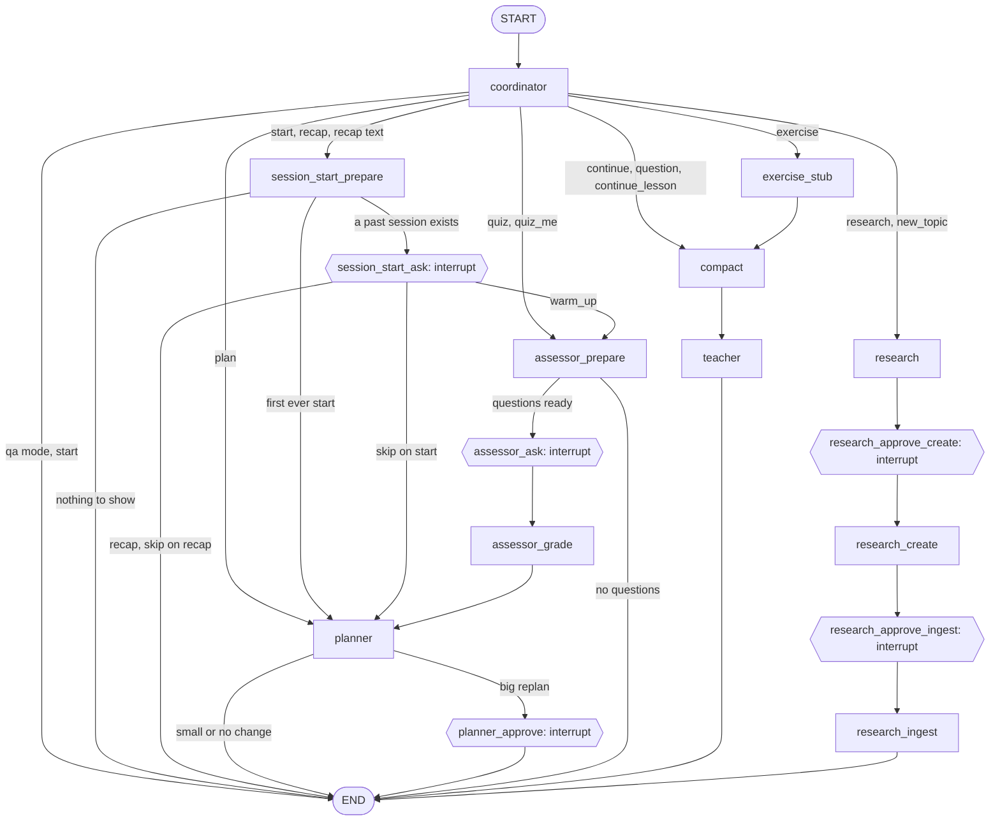

# The tutor

The tutor is a LangGraph graph that runs one learner turn at a time over the roadmap you ingested. LangGraph only
orchestrates: every model call goes through `backend/core/llm.py` (`haiku_json`, or the HF-frozen
`backend/agent/loop.py:run_tool_loop`), and every model-chosen tool call goes through the MCP gateway
([mcp.md](mcp.md)) with the node's agent name. Code: `backend/tutor/tutor/`; HTTP: `backend/tutor/tutor_api.py` and
`backend/tutor/memory_api.py`. The behaviour below is covered by the tests in `backend/tutor/tests`; the numbers are
the constants in that code.

## The graph

A turn is a button (`start`, `continue`, `quiz`, `recap`, `plan`, `research`), free text, or the resume of a pending
interrupt. Buttons route by a fixed map with no model call; text is classified by the coordinator (one low-effort
Haiku call with the schema `TutorRoute`). Routes: `continue_lesson`, `question`, `quiz_me`, `exercise`, `new_topic`,
`recap`. No route is named for flashcards.



Notes on the diagram:

- Nodes are grouped: `session_start` (2 nodes), `planner` (2), `teacher` (`compact`, `teacher`), `assessor` (3),
  `researcher` (5), `exercise_stub`. Interrupt nodes call `interrupt()` as their first statement (LangGraph re-runs a
  node from the top on resume), so the work before an interrupt is done in the node before it and kept in state.
- Every researcher edge also goes to END when `state.proposal` is cleared (no topic, nothing found, an error, a
  decline). `planner_approve` always ends the turn.
- In **qa** mode (free Q&A, no plan): `start` ends the turn with no reply, `research` and `new_topic` still go to
  the researcher, every other button or route goes to the teacher. The UI shows only the composer and "Teach me
  something new" there.
- `exercise` is classified but not built: the coordinator route goes to `exercise_stub`, which replies "Code
  exercises arrive in a later version; here is the concept instead." and then the teacher answers.
- A text or action turn while an interrupt is pending **abandons** that interrupt (R5): the learner moved on, the
  state before it is kept. Only a resume needs a pending interrupt (`BadResume` otherwise).
- One turn at a time per session (a second one gets `Busy`, HTTP 409). Ending a session, or creating a new one on
  the roadmap, waits up to `END_WAIT_S` = 120 s for the running turn (R7); one active session per roadmap is
  enforced by a partial unique index.

## Nodes: agent, effort, tools

Effort is fixed per agent for prompt caching. Prompts are module constants with no timestamps or learner data; the
learner snapshot, today's plan and passages go in the user turn.

| Node | Agent (gateway) | Model call and effort | Tools |
| --- | --- | --- | --- |
| `coordinator` | none | `TutorRoute`, `low`, memoised (`llm_memo`); buttons skip it | none |
| `session_start_prepare`, `session_start_ask` | none | none (answered from stored summaries) | none |
| `planner`, `planner_approve` | none | none (deterministic) | none (reads and writes the plan tables directly, D5) |
| `compact` | none | `RunningSummary`, `low`, only when the history is over the working-memory budget | none |
| `teacher` | `teacher` | the tool loop, `AGENT_EFFORT` (default `low`); plus `WebContradiction`, `low` | the `teacher` allow-list (see [mcp.md](mcp.md#agent-allow-lists-and-rules)) and the local `propose_resource` |
| `assessor_prepare` | `assessor` | `Quiz`, `low`, only for questions the stored ones do not cover | `kb.search` |
| `assessor_grade` | none | `Grade`, `low`, memoised, only for short answers | none |
| `research` | `researcher` | the tool loop, `AGENT_EFFORT` (R11) | the `researcher` allow-list without `ingest.*` |
| `research_create`, `research_ingest` | `researcher` | none | `ingest.create_roadmap`, `ingest.approve_roadmap` (ask tools, approved by the card) |
| `curate_session` (job) | none | `SessionCurate` with `consent_personal`, else `SessionCurateNoFacts` (asks for no facts); `low`; not memoised (R17) | none |
| `summarize_document` (job) | none | `SectionNotes`, `low` | none |

The researcher's effort is not pinned: it follows `AGENT_EFFORT` through the frozen `default_model_turn`, so
raising `AGENT_EFFORT` for the teacher raises the researcher too (R11).

**The memo (`llm_memo`).** It holds only coordinator routes (`TutorRoute`) and quiz grades (`Grade`), keyed by a hash
of the model, prompt, schema and effort (`tutor/memo.py`). Nothing personal is memoised: the table is outside
consent, export and purge. The curator therefore calls `haiku_json` directly (R17), and migration `0010` deleted the
curator replies older builds had memoised (rows whose `response` has `resolved_weak_spots`).

## Budgets and failures

Per turn, configurable (`backend/.env.example`):

| Budget | Default | Where |
| --- | --- | --- |
| `TUTOR_MAX_STEPS` | 6 model turns in a tool loop | `settings.py:54` |
| `TUTOR_MAX_TOKENS` | 60,000 (input + output + cache write + 0.1 × cache read, rounded, summed over the turn's spans; R20) | `settings.py:55`, `tutor/budget.py` |
| `TUTOR_MAX_USD` | $0.02 (the hard limit: it prices every token kind) | `settings.py:56`, `tutor/budget.py` |

Breaching tokens or dollars (strictly over) ends the turn with this exact message (`tutor/budget.py:20`):

> This turn reached its {kind} budget ({used} of {limit}). Your session is saved; ask again to continue.

`kind` is `token` or `cost`; used and limit are `62000 of 60000` or `$0.0213 of $0.0200`. Cache reads count a tenth
toward the token budget (R20): a tool loop re-reads its cached prompt on every step, and counting those reads in full
ended ordinary turns early; the dollar cap stays the hard limit. The step limit is enforced by the tool loop itself:
its last step is forced to answer without tools, and that answer carries the notice "I reached this turn's step
limit; the answer may be incomplete." An answer cut at the output length limit carries "The answer was cut off at
the length limit." (M11; for the researcher the notice is appended to the first card's summary). A contradiction
notice, when there is one, is appended after it. The check runs before each model step, so a turn can end over the limit by one step's
cost.

A model call that raises `LLMUnavailable` is retried twice, after 1 s and then 2 s (`tutor/budget.py:15`). After
that the turn streams `{"type": "error", "message": "The model is unavailable right now. Your session is saved; try
again in a minute."}` and ends. The checkpoint keeps the state of the last completed step. The `done` event always
comes last and carries the redacted trace summary; the session's `cost_usd` grows by the turn's cost and its
`last_turn_at` is stamped.

Any other exception after the stream has started is logged and ends the stream with `{"type": "error", "message":
"Something went wrong; your session is saved."}` and no `done` (its trace summary died with the turn; the cost is
still recorded). The UI shows that message and reloads the saved session (M2). Session ids are canonicalised
(`str(uuid.UUID(id))`) at every runtime entry point, so an upper-case id uses the same turn lock and checkpoint
thread; a malformed id is a 404 (M3).

The contradiction check is an enhancement, not the answer (R9): when it fails (outage or budget) the finished answer
is kept without a notice, and it is skipped when no web excerpt was found.

## Memory layers

| Layer | What it holds | Where it lives |
| --- | --- | --- |
| Working | the session's messages, a running summary of folded turns, today's card, the quiz in flight, the mastery log | the LangGraph checkpoint in Postgres (LangGraph's `checkpoint*` tables, thread id = session id) |
| Episodic | each ended session's title and summary (cost, started and ended times) | `tutor_sessions` |
| Semantic | facts, preferences and goals about the learner (at most 1000 characters each), with an embedding | `learner_facts` (Postgres, pgvector), only with `consent_personal` |
| Progress | per-skill mastery, weak spots (at most 10), next review date (the lock state is computed from prerequisites) | `skill_progress` |
| Plan | versioned study plans (`active`, `proposed`, `superseded`) and study settings | `study_plans`, `study_settings` |
| Knowledge | the roadmap's chunks and section summaries | Qdrant and `sections` (not learner data) |

**Compaction.** Before the teacher runs, `compact` estimates the history as characters / 4. Over
`WORKING_MEMORY_TOKENS` (12,000) it folds the oldest user/assistant pairs into `state.summary` until the estimate
is at most 0.6 of that budget, never the last 2 pairs and never this turn's unanswered message
(`tutor/compaction.py:26-27`). The summary rides as a `<summary>` prefix on the first user message. Between
compactions the stored history only grows at its end, so each request extends the previous one for the prompt
cache; a compaction is the one allowed break, and costs one cache miss.

**Raw messages.** The checkpoint is the raw-message store (D3). Whatever deletes or reads raw messages needs the
saver; without it those routes answer 503 before changing anything.

## Consent and retention

Two consents, both unset until the first-run dialog asks (`GET/PUT /api/learner/settings`), plus `retention_days`
(default 90, 1 to 3650).

**Personal memory (`consent_personal`).** Needed to write facts. While it is off, `learner.recall` and
`learner.list_facts` return `[]` and the Memory API lists none. Turning it off purges every fact (D4) and needs
`confirm_purge: true` (otherwise 409 with the count). The settings change and the purge happen in one transaction.
The tutor writes facts only through the curator when a session ends; the learner can edit or delete them in the
Memory & privacy page.

**Raw messages (`consent_raw_messages`).**

- Off (the default): the curator deletes the session's checkpoint thread right after it writes the summary. The
  summary stays; the messages do not.
- On: the thread is kept (`raw_kept=true`) and deleted by the retention sweep once the session ended more than
  `retention_days` ago.
- Turning it off deletes the threads of ended sessions that kept theirs, before the settings change (R14).
  Active sessions are left alone; the curator decides when they end, from the consent in force then.

**The sweep** (`tutor/retention.py`) runs at startup and every 6 h (`RETENTION_EVERY_S` = 21,600). In order:

0. End every active session idle for over 6 h (`IDLE_END_S` = 21,600), measured from `last_turn_at` (stamped at the
   end of each turn), or from `started_at` before any turn (R19). It ends them through `TutorRuntime.end_session`,
   so the turn lock (R7), curation and D3 apply; a session whose turn is running is skipped and retried next pass,
   and one used since it was found idle is left active. The UI reopens a roadmap's active session, so without this
   an abandoned session would keep its raw messages forever and never be summarised.
1. Re-enqueue `curate_session` for every ended, uncurated session, and revive jobs that died under their key (status
   queued, attempts 0), so a long model outage does not lose a session (R13).
2. Drop the raw thread of any session that ended more than 24 h ago (`UNCURATED_GRACE_S` = 86,400) and was never
   curated, unless raw messages are consented to (R13, D3: no raw messages without consent, even when curation keeps
   failing). The curator later treats a missing thread as an empty session ("No conversation in this session.").
3. Delete threads past `retention_days` that still have `raw_kept`.
4. Finish a partial revoke (R14): delete every `raw_kept` thread while `consent_raw_messages` is not true, and purge
   every fact while `consent_personal` is false. Cleanup is state-based, not transition-based, so a crash between a
   revoke's steps is finished by the next sweep (within 6 h) instead of leaking data.

**Other privacy controls.** `DELETE /api/sessions/{id}` (ended sessions only) removes the thread and the row;
`DELETE /api/roadmaps/{slug}/progress/{skill_id}` resets a skill; `GET /api/learner/export` downloads everything
(settings, facts without embeddings, progress, sessions, study settings, plans, and the kept raw messages) redacted, as
`roadmap-tutor-export.json`.

**No agent remembers or forgets (M7).** The teacher has `learner.recall` only; no agent's allow-list includes
`learner.remember` or `learner.forget`. Facts are written only by the curator when a session ends (with
`consent_personal`), and edited or deleted only by the learner on the Memory & privacy page. User text is redacted (`backend/core/redact.py`) before it enters graph state, the
database or a trace.

## Mastery and review

Each graded question scores 0 to 1 (multiple choice: 1 or 0; short answers: a `Grade` call, clamped to 0..1). A quiz
has `QUIZ_SIZE` = 3 questions. The skill's new mastery is an exponential moving average of the quiz mean
(`tutor/mastery.py:6`):

```
new = clamp(old + 0.35 * (mean_score - old), 0, 1)
```

The next review date is `now` plus:

| New mastery | Interval |
| --- | --- |
| below 0.5 | 1 day |
| 0.5 to below 0.7 | 3 days |
| 0.7 to below 0.85 | 7 days |
| 0.85 or more | 14 days |

Weak spots: a question scored under 0.5 adds its concept to the skill's weak spots; one scored 0.8 or more removes
it; the newest 10 are kept. A skill unlocks when its prerequisites reach 0.7 mastery (`DEFAULT_UNLOCK`, adjustable
per roadmap). The curator also clears a weak spot the session resolved, but only for a skill whose mastery rose in
that session. Questions come first from the starter questions stored on the skill's sections at ingestion; only the
missing ones are generated, from one `kb.search`.

## The planner

Deterministic, no model call (D2). The plan is one skill per session, in spec order made consistent with
prerequisites (a prerequisite cycle is broken at the first unplaced skill).

- Skills at or above mastery 0.85 are left out (`skipped_mastered`).
- A skill is planned `max(1, ceil(objectives / 2))` times.
- Sessions per week: `floor(weekly_hours * 60 / session_minutes)`, at least 1, on the chosen study days.
  Defaults: 5 hours a week (the spec's `weekly_hours` wins when set), 45-minute sessions, Monday to Friday.
  Ranges: hours more than 0 and at most 80, minutes 15 to 240.
- With a deadline, the plan reports `fits_deadline`.
- **Big replan (D2 as amended by R8).** Compare the skills planned for the next 5 sessions (`HORIZON`) of the active
  and the new plan. The change is `max(|new - old|, |old - new|)` over those two sets of skill ids; it is **big at
  2 or more** (`BIG_CHANGE`). The approval card's number uses the same count. A small change applies silently and a
  new plan with no earlier one is saved as active.
- A big replan is stored as `proposed` and asked through an approval card (`replace_plan`); approving makes it
  active, declining supersedes it.

## Approval cards and resume shapes

Every approval interrupt has the shape `{"kind": "approval", "id", "action", "summary", "payload"}`, and the UI
shows the raw `payload` next to the summary (spec, Phase 3 amendments). The `id` is a uuid made before the interrupt
and kept in state. Resume shapes, checked before the graph runs (`BadResume`, HTTP 422, state unchanged):

| Interrupt `kind` | Resume value |
| --- | --- |
| `approval` (`replace_plan`, `create_roadmap`, `approve_roadmap`) | `{"approved": bool, "card": <the card's id>}`, exactly those keys (R10, amends D8) |
| `quiz` | `{"answers": {question id: text}}` with exactly the card's question ids, each answer at most 2000 characters |
| `session_start` | `{"choice": one of the card's options}`, plus `"session_id"` for `recap_earlier` |

The `card` id means a replayed approval can never approve a card the learner has not seen. Gateway `ask` tools get a
sync approver built from the payload the learner approved (`payload["args"] == approved args`), never tied to
FastAPI's loop.

The session-start card offers `recap_last`, `recap_earlier` (the 5 sessions before the last), `warm_up` (a quiz on
the skill with the most weak spots) and `skip`; it is answered from stored summaries.

## Sources

- **Roadmap** sources are the citations `run_tool_loop` renders from `kb` passages.
- **Web** sources (R21, amends D11) are URLs that a tool result of this turn named as a source **and** that appear in
  the answer text. Only these count: the result URLs of the registry's `url_sources` tools (search tools: a
  `web.search` result's `results[*].url`, else the URLs in a text result), `web.fetch`'s `final_url`, and browser
  `Page URL:` lines. A URL inside a fetched page's body or a browser snapshot never counts: a page can name any
  host. They are matched by URL text, not by meaning. The researcher's allowed URL set is built the same way.
- Links in the answer are sanitised to roadmap source URLs, web source URLs and the learner's own URLs.
- **The web UI links only those (R16).** A reply's text links only URLs in that reply's `sources` (roadmap and web)
  or in the learner's own messages, compared after dropping a trailing `/`; any other URL stays plain text. Code
  spans (the sanitiser's neutralised URLs among them) render as `<code>` and are never links, and the reply that is
  still streaming (raw, unsanitised model text) renders as plain text with no links at all.
- With both kinds present and a web excerpt to compare, one `WebContradiction` call may add a one-sentence notice to
  the reply.
- Roadmap passages and every tool result are untrusted data; the teacher prompt says so, and passages are fenced
  before they reach a side call.
- The teacher may call `propose_resource` for a page seen this turn; it is stored as a `proposed` resource that you
  approve or dismiss in the ingestion report, like the ingestion agent's.

## Summaries at ingestion

After a document is indexed, a `summarize_document` job writes, for its sections, a 1 to 2 sentence summary and 2
starter questions, in batches of up to 8 sections per call (`BATCH` = 8, each section cut at 6,000 characters in
the prompt). A video document also gets a card summary. The questions feed the assessor.

The roadmap's summary spend is capped at `INGEST_SUMMARY_BUDGET_USD` (default $0.50), checked before every batch;
once the spend reaches the cap the job still completes, with `{"skipped": "budget"}`. A failed attempt's spend is kept so a retry
counts it. A model that is down makes the job back off and retry. `INGEST_SUMMARIES=false` turns them off.

## The browser lease

There is one shared Playwright page, so the gateway hands it out as a lease (D9, R4; details in
[mcp.md](mcp.md#the-browser-lease)). A tutor turn holds the lease under its session id and releases it when the turn
ends, however it ends; each crawler render holds its own. A lease ends at release or after 60 s without a call
(`LEASE_IDLE_S`). A call from another lease waits up to its own timeout, then gets `browser busy: another session is
using it`. A newly acquired lease first resets the page to `about:blank`. Browser calls run one at a time even inside
one lease, because a turn's tool calls are issued in parallel (R4). A crawler render that is refused as busy is
retried by the queue instead of being skipped (R3).

## The researcher and its safety

"Teach me X" becomes a mini roadmap the learner approves twice: card 1 creates a draft (`ingest.create_roadmap`),
card 2 starts ingestion (`ingest.approve_roadmap`). The prompt asks for at most 3 stages, 8 skills and 12
resources; the 12-resource limit is also enforced by the link stripping below. The
streamed text is a draft and is not shown; the learner sees the cards. The model never sees the `ingest.*` tools.

Safety rests on these controls:

- **Link stripping.** A link survives only if its URL appeared in a tool result of this turn and passes the URL
  policy; others are reduced to their title, bare URLs are removed, and URLs past 12 are neutralised. Titles are
  rebuilt without title attributes and URLs inside titles are removed. Any URL the parser's own extractor, or any
  scheme in any case, could read from the result must be one that survived.
- **The spec is cleaned before card 2 (R12).** Scheme-less or obfuscated URLs (`www.x`, `x.example/p`, escaped,
  full-width or percent-encoded schemes) survive stripping and can reach ingestion through the parse model's
  `url_hint`. After `create_roadmap` parses, every parsed resource `url` and `url_hint` not in this turn's allowed
  set is cleared and the spec is saved again. A cleared resource may still be found by search.
- **Queries are scrubbed and the choices approved (R18).** Every resource `query` loses its host-like tokens
  (`x.example`, `a.b.co.uk`, `www.` forms, schemes, percent-encoding; NFKC first, so full-width dots count) and its
  search operators (`site:`, `inurl:` and the like), so search cannot be steered to an injected host. Then
  `research_create` resolves each resource's URL once, through the ingestion server's own `resolve_choices` (a
  resource's own URL, else its top candidate, else null), and card 2 shows that `choices` map in
  `approve_roadmap`'s args. `approve_roadmap` given `choices` validates each URL (`validate_crawl_url`) and ingests
  exactly those, without resolving again; `choices` is part of its idempotency args. The approver compares args, so
  the approval covers exactly the URLs ingested.
- **The elicitation dependency.** `create_roadmap` asks the human through MCP elicitation, and a client that accepts
  would approve and ingest the uncleaned text. The researcher is safe only because the gateway's client has **no
  elicitation handler**, so the call counts as declined and the roadmap stays `parsed`. Do not add an elicitation
  handler to the gateway without moving the cleaning before `create_roadmap`.
- **Idempotency keys** (`<key>:create`, `<key>:approve`) make a retried card harmless.

## Known limits

- **No exercises or flashcards until Phase 5.** The `exercise` intent gets the fixed reply above; `run_code` and the
  user-toggled flashcard mode (FSRS) arrive with the sandbox.
- **Curation needs `INGEST_WORKERS` of at least 1.** `curate_session` and `summarize_document` are jobs on the
  durable queue; with `INGEST_WORKERS=0` they wait, summaries and facts are not written, and (without raw consent)
  the sweep drops the thread after 24 h, so that session's summary input is lost.
- **Web sources are matched by URL text.** An answer that names a seen URL in text counts as citing it.
- **Compaction costs one cache miss** each time it folds the history.
- **The researcher's effort follows `AGENT_EFFORT`** (R11), not a separate setting.
- **After a reload the chat shows reply text only**, without the sources or notices: the checkpoint stores messages,
  not the reply events.
- **Query scrubbing drops dotted words.** A query word such as `node.js` looks like a host and is dropped (R18);
  the rest of the query still searches.
- **The gateway's hand-over reset is not retried.** When a new browser lease's `about:blank` reset fails, the call
  is neither retried nor refused.
- **Section and video summaries are stored but shown only in the ingestion report;** the model's misconceptions are
  discarded.
- **The checkpoint saver has no reconnect.** It holds one long-lived connection; if it drops, restart the API.
- **Export includes messages only for ended `raw_kept` sessions**, not for the active session.
- **Revoke is eventually complete.** A crash between a revoke's steps is finished by the next sweep, within 6 h.
- **The summary cap is checked per batch.** Jobs running at the same time do not see each other's spend in flight,
  so the cap can be passed by up to one batch per worker.
- The semantic answer cache for factual Q&A moves to Phase 6, where the cost eval measures it. Phase 4 memoises only
  deterministic calls (`llm_memo`).
